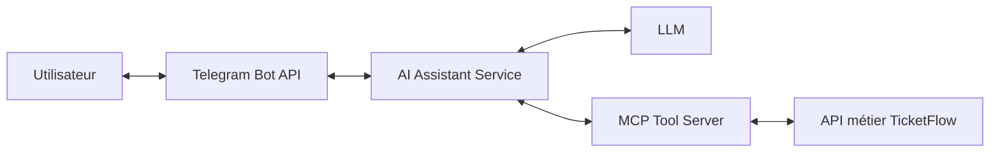

# AI Assistant Service — conception initiale

## Statut et références

Ce document décrit une architecture à discuter, sans implémentation. Le périmètre documentaire est présenté dans le [README](README.md). Les rôles Telegram–LLM–MCP proviennent de l'extrait du cahier des charges partagé dans la conversation « Résumé cahier des charges », lignes 7 et 8 du tableau des microservices. Les autres références vérifiables sont le [README racine](../../README.md), les [consignes du dépôt](../../AGENTS.md), le [POM parent](../../pom.xml) et les sources de Customer Service citées ci-dessous.

Le cahier des charges intégral n'est pas versionné. Les choix de transport, DTO et opérations HTTP ci-dessous sont **à valider** ; les priorités suggérées dans la conversation antérieure ne sont pas reprises comme engagements.

## Architecture générale

Les flèches représentent des échanges logiques et ne fixent ni protocole MCP ni déploiement. Telegram transmet les messages à l'assistant ; l'assistant dialogue avec le LLM et reste responsable de l'exécution contrôlée des appels MCP. Le LLM peut proposer un appel d'outil, mais ne reçoit ni accès direct aux API métier ni identifiants de base de données. Le serveur MCP accède aux services par leurs contrats publics, avec l'autorisation requise.

Gateway, Eureka et Config Server appartiennent au socle existant ; la route, l'enregistrement et la configuration de l'assistant ne sont pas définis dans cette contribution.

## Frontières de responsabilité

| Composant | Responsabilités | Limites |
|---|---|---|
| Adaptateur Telegram de l'assistant | Vérifier l'origine, lire le message, gérer l'acquittement et préparer l'envoi de la réponse. | Une identité Telegram ne prouve pas une identité TicketFlow. La stratégie de reprise reste à choisir. |
| Orchestration de l'assistant | Préparer le contexte minimal, appeler le modèle, filtrer les outils proposés, restituer les résultats ou un échec explicite. | Ne décide pas des stocks, prix, droits, confirmations ou paiements ; ne remplace pas les règles des services propriétaires. |
| LLM | Interpréter le texte et proposer une réponse ou un appel d'outil. | Ses sorties et les contenus récupérés restent des données non fiables ; ils ne peuvent accorder de droits. |
| Client MCP de l'assistant | Appeler uniquement les outils autorisés dans le contexte de l'utilisateur. | Pas d'outils arbitraires, pas de connexion directe aux bases ou de contournement des contrôles serveur. |
| MCP Tool Server | Exposer les outils, valider les arguments et les autorisations, adapter les appels aux API métier. | Son contrat appartient à son responsable ; aucun outil ou DTO n'est défini à sa place ici. |
| Services métier | Posséder leurs données et appliquer leurs règles et contrôles sur les ressources. | Leurs réponses sont la source des faits métier ; le modèle ne doit pas inventer un résultat réussi. |
| Notification Service | Porter confirmations, rappels et notifications métier selon l'extrait du sujet. | Partage éventuel du bot et coordination avec les réponses de dialogue à préciser. |

Ces composants sont logiques : aucun paquet Java, stockage ou nouvelle dépendance n'est imposé.

## Interactions envisagées

### Message Telegram

1. Telegram envoie un `Update` JSON au webhook HTTPS proposé dans [OpenAPI](docs/openapi.yaml). Le secret `X-Telegram-Bot-Api-Secret-Token` sert à vérifier l'origine dans la proposition ; il ne donne aucun droit métier.
2. L'adaptateur valide l'enveloppe. Le schéma représente une projection de `Update`, pas un DTO TicketFlow : `message` et `text` sont facultatifs et les propriétés Telegram supplémentaires sont tolérées. Proposition : acquitter sans appel LLM les types non pris en charge.
3. L'assistant fournit au LLM le texte et le contexte strictement nécessaires. Pour les demandes métier, il n'expose que les outils dont l'usage est autorisé ; l'accès aux réservations dépend d'une identité TicketFlow établie et vérifiée.
4. Si un outil est requis, l'assistant contrôle le choix et les arguments puis appelle MCP ; MCP et le service propriétaire appliquent les droits sur les ressources. L'absence de contrat ou d'identité empêche l'accès concerné.
5. L'assistant prépare une réponse fondée sur le résultat et l'envoie par la Bot API. Un échec LLM/MCP/Telegram doit rester explicite ; il ne prouve ni absence d'événements ni réussite d'une opération métier.

L'acquittement HTTP du webhook n'est pas la réponse au dialogue. La proposition utilise `200` sans corps pour une mise à jour traitée, un doublon déjà pris en charge ou un type volontairement ignoré. Le moment exact de l'acquittement, le traitement synchrone ou différé et la prise en charge durable avant acquittement restent à valider ; aucune file de messages n'est supposée existante.

Telegram relivre les requêtes dont la réponse n'est pas `2xx`. Avant implémentation, définir la déduplication par bot et `update_id`, sa durée et sa persistance ainsi que les reprises après échec d'envoi. Éviter un acquittement prématuré qui perdrait la demande ou un traitement long qui entraînerait des réponses répétées. Une panne après acquittement ne peut plus être signalée par un nouveau statut HTTP au même appel Telegram.

### Dialogue HTTP facultatif

`POST /api/ai-assistant/chat` est une proposition pour tester ou consommer l'orchestration indépendamment de Telegram. Le besoin d'exposer cette interface doit être confirmé. Le contrat propose un échange synchrone `{message}` → `{reply}`, sans envoi Telegram, sans historique et sans création de conversation persistante.

Un jeton Bearer est proposé ; son émetteur, audience et règles d'accès restent ouverts. L'identité doit provenir du jeton validé, jamais d'un `customerId` fourni librement. Aucun rôle ou scope n'est inventé. Cette sécurité ne s'applique pas au webhook Telegram, qui utilise son secret d'origine propre.

La limite proposée de 4 000 caractères est un choix interne à discuter ; elle n'est pas une règle Telegram ou LLM. Les erreurs prévues sont 400 (requête invalide), 401 (authentification absente/invalide), 403 (accès refusé), 415 (type de contenu), 429 (limitation), 500 (erreur interne), 502 (échec amont), 503 (indisponibilité) et 504 (délai amont). Limites, délais et reprise restent à préciser ; aucun retry d'écriture métier n'est ajouté.

## Cohérence avec la branche examinée

| Élément inspecté | État réel et conséquence pour l'assistant |
|---|---|
| `services/customer-service/README.md` et `src/main/java/com/ticketflow/customerservice/controllers/CustomerController.java` | API existante : POST/GET `/api/customers`, GET/PUT/DELETE `/api/customers/{id}`. Création 201 avec `Location`, lecture/modification 200, suppression 204. Aucun endpoint de recherche par e-mail ni de liaison Telegram disponible. |
| `services/customer-service/src/main/java/com/ticketflow/customerservice/dto/CustomerRequest.java` et `CustomerResponse.java` | Requête : `firstName`, `lastName`, `email` obligatoires, `phone` facultatif. Réponse : `id` de type `Long`, mêmes données de profil et `createdAt`. Aucun champ Telegram ni identité Keycloak dans ces DTO. Aucun DTO client n'est recopié dans le contrat assistant. |
| `services/customer-service/src/main/java/com/ticketflow/customerservice/exceptions/ApiExceptionHandler.java` | `ProblemDetail` : 400 validation, 404 client absent, 409 e-mail dupliqué. Réutilisation proposée du format d'erreur, sans importer ces erreurs métier comme opérations de l'assistant. |
| README de Customer Service | Le profil métier est distinct de l'authentification, prévue avec Keycloak ultérieurement. Posséder un identifiant de client ou lister les clients ne permet pas d'authentifier un utilisateur Telegram. |
| `pom.xml` parent | Java 21, Boot 4.0.8, Cloud 2025.1.2 ; modules Customer, Gateway, Discovery et Config seulement. Compatibilité et version Spring AI à vérifier séparément. |
| `services/api-gateway/src/main/resources/application.yaml` | Charge sa configuration depuis Config Server ; aucune route assistant définie dans ce fichier. La configuration externe et un routage effectif ne sont pas vérifiés ici. |
| Dossiers `services/` et fichiers versionnés | Event, Booking, Payment, Ticket, Notification et MCP absents ; aucun contrat OpenAPI métier versionné trouvé. Les API Java/README de Customer constituent les seules interfaces métier observables, sans test d'un service lancé. |

La cohérence vérifiable est donc structurelle et documentaire. Recherche d'événements, détails et réservations nécessitent les contrats des responsables concernés. Aucun nom d'outil, chemin Event/Booking, topic Kafka ou schéma de réponse métier futur n'est fixé.

## Sécurité, données et indisponibilités

Les secrets Telegram, LLM et MCP devront être externalisés. Ne pas transmettre le jeton Telegram, le Bearer utilisateur, des données personnelles non nécessaires ou des détails techniques sensibles au modèle, dans les journaux ou dans les erreurs publiques. Définir le contexte autorisé, sa rétention et sa suppression avant toute mémoire conversationnelle.

Le filtrage des outils côté assistant complète les contrôles MCP et métier ; il ne les remplace pas. Les messages utilisateurs, sorties du modèle et résultats d'outils ne peuvent modifier les autorisations. Une demande d'accès à une réservation d'autrui doit être refusée côté serveur, même si elle est formulée dans une instruction au modèle.

Le contrat propose `application/problem+json`, proche de la convention existante. Les détails doivent être compréhensibles sans secrets ni réponse brute du fournisseur. Aucun résultat métier de substitution n'est prévu lors d'une indisponibilité. Les scénarios de validation futurs incluent entrées invalides, secret/jeton invalide, accès interdit, outil non autorisé, doublons Telegram et pannes/délais LLM, MCP et Bot API ; ils ne sont pas exécutés à ce stade documentaire.

## Questions ouvertes pour la réunion

1. Confirmer les fonctions attendues et leurs priorités à partir du cahier des charges intégral : recherche, détails, réservations autorisées, recommandations et RAG.
2. Valider le webhook, son chemin, son exposition HTTPS, les types de mises à jour, le secret et la gestion des doublons. Choisir traitement synchrone ou différé et garantie de prise en charge avant acquittement.
3. Conserver ou retirer l'interface HTTP facultative ? Valider ses DTO, sa limite de texte, les statuts, délais et règles de reprise.
4. Fournir le catalogue, les schémas, le transport, les erreurs et la sécurité MCP ainsi que les contrats Event/Booking et les règles d'autorisation sur les réservations.
5. Définir la liaison Telegram–TicketFlow, l'émetteur et l'audience des jetons, les droits et leur propagation jusqu'aux API métier, sans confondre profil client et authentification.
6. Choisir le fournisseur LLM, la version Spring AI compatible, les données autorisées à quitter TicketFlow et les limites de coût et de latence.
7. Décider si un historique est nécessaire, avec durée de conservation et suppression ; aucun stockage retenu pour l'instant.
8. Clarifier la propriété du bot si Notification Service envoie aussi sur Telegram et les responsabilités d'envoi/reprise.
9. Définir ultérieurement port, configuration, découverte, routage et exploitation, sans modifier le socle pédagogique pour cette livraison.

## Références de protocole

- [Telegram Bot API — Update](https://core.telegram.org/bots/api#update) : enveloppe des messages reçus.
- [Telegram Bot API — setWebhook](https://core.telegram.org/bots/api#setwebhook) : POST HTTPS, secret d'origine et relivraisons hors `2xx`.
- [OpenAPI 3.0.3](https://spec.openapis.org/oas/v3.0.3.html) : format du contrat prévisionnel, sans serveur d'exécution annoncé.
