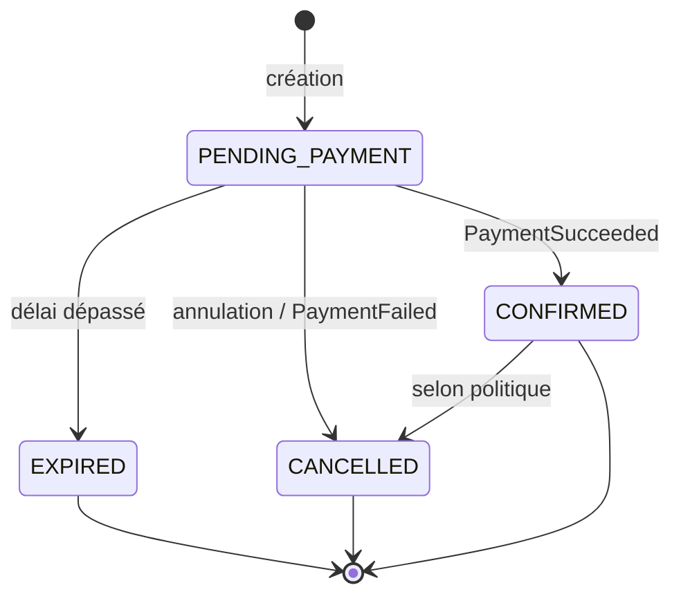

# Booking Service : Conception technique

## 1. Architecture interne

Architecture en couches, avec séparation stricte entre API, logique métier et persistance.

```
Client / Gateway
      │
      ▼
┌────────────────┐
│  controller    │  REST, validation des entrées, DTO
├────────────────┤
│  service       │  règles métier, transitions, idempotence
├────────────────┤
│  repository    │  Spring Data JPA
├────────────────┤
│  PostgreSQL    │  booking_db (Flyway)
└────────────────┘

Sorties :  client/ (OpenFeign) → Event Service, Customer Service
           messaging/ (Kafka producer / consumer)
           scheduler/ (expiration)
```

### Structure des packages

```
com.ticketflow.booking
├── controller/        BookingController
├── service/           BookingService, BookingExpirationService
├── repository/        BookingRepository
├── domain/            Booking, BookingLine, BookingStatus
├── dto/               CreateBookingRequest, BookingResponse, ErrorResponse...
├── mapper/            BookingMapper
├── client/            EventClient, CustomerClient (OpenFeign + fallbacks)
├── messaging/         producers, consumers, events
├── scheduler/         ExpirationScheduler
├── security/          résolution de l'identité (JWT / profil dev)
├── exception/         exceptions métier, GlobalExceptionHandler
└── config/            Feign, Kafka, OpenAPI
```

### Principes
- **DTO séparés des entités** : les entités JPA ne sont jamais exposées par l'API.
- **Gestion d'erreurs globale** via `@RestControllerAdvice`, réponse `ErrorResponse` structurée, sans stack trace.
- **Identité issue du JWT** : jamais de `customerId` fourni par le client.
- **Base propriétaire** : aucune jointure ni écriture vers les tables d'un autre service.

---

## 2. Modèle de données

### Entité `Booking`

| Champ | Type | Contraintes |
|---|---|---|
| `id` | UUID | PK |
| `customer_id` | UUID | NOT NULL, issu du JWT |
| `event_id` | UUID | NOT NULL |
| `status` | VARCHAR | NOT NULL (`BookingStatus`) |
| `total_amount` | NUMERIC(12,2) | NOT NULL, figé à la création |
| `currency` | CHAR(3) | NOT NULL (ex. `MAD`) |
| `expires_at` | TIMESTAMPTZ | NOT NULL, utile pour `PENDING_PAYMENT` |
| `idempotency_key` | VARCHAR(100) | NOT NULL, **UNIQUE** (par client) |
| `payment_reference` | VARCHAR(100) | nullable, rempli à la confirmation |
| `cancel_reason` | VARCHAR(255) | nullable |
| `version` | BIGINT | verrouillage optimiste |
| `created_at` | TIMESTAMPTZ | NOT NULL |
| `updated_at` | TIMESTAMPTZ | NOT NULL |

### Entité `BookingLine`

| Champ | Type | Contraintes |
|---|---|---|
| `id` | UUID | PK |
| `booking_id` | UUID | FK → `booking.id`, NOT NULL |
| `ticket_tier_id` | UUID | NOT NULL |
| `quantity` | INT | NOT NULL, `>= 1` |
| `unit_price_snapshot` | NUMERIC(12,2) | NOT NULL, prix à la date de réservation |

Relation : un `Booking` possède 1..n `BookingLine`.

### Table de traitement idempotent des événements consommés

| Champ | Type |
|---|---|
| `event_id` | UUID (PK) : identifiant du message Kafka déjà traité |
| `processed_at` | TIMESTAMPTZ |

### Index recommandés
- `UNIQUE (customer_id, idempotency_key)`
- `INDEX (customer_id, created_at DESC)` pour `/me/bookings`
- `INDEX (status, expires_at)` pour le job d'expiration

### Migration Flyway
`src/main/resources/db/migration/V1__init_booking.sql`

---

## 3. Statuts et transitions



| De | Vers | Déclencheur |
|---|---|---|
| `PENDING_PAYMENT` | `CONFIRMED` | `PaymentSucceeded` |
| `PENDING_PAYMENT` | `EXPIRED` | `expires_at` dépassé (scheduler) |
| `PENDING_PAYMENT` | `CANCELLED` | annulation client ou `PaymentFailed` |
| `CONFIRMED` | `CANCELLED` | annulation selon la politique configurée |

**Toute autre transition est refusée** (HTTP 409, code `INVALID_STATE_TRANSITION`). `EXPIRED` et `CANCELLED` sont des états terminaux.

---

## 4. Règles métier

| # | Règle |
|---|---|
| R1 | Quantité par commande limitée (`booking.max-quantity-per-order`, défaut 10) et `>= 1` |
| R2 | Le stock ne devient jamais négatif ; la réservation de capacité est **atomique** |
| R3 | Seuls les événements au statut **publié** et ouverts à la vente sont réservables |
| R4 | Le prix est **figé à la création** (`unit_price_snapshot`, `total_amount`) |
| R5 | Une réservation `PENDING_PAYMENT` expire après `booking.hold-duration` (défaut 15 min) |
| R6 | L'expiration et l'annulation **restituent la capacité** |
| R7 | La confirmation ne se produit **qu'une seule fois** (idempotente) |
| R8 | L'identité vient du JWT ; un client ne voit que **ses** réservations (403/404 sinon) |
| R9 | `Idempotency-Key` : même clé + même corps → même réponse ; même clé + corps différent → 409 |
| R10 | Les événements Kafka consommés sont traités de façon idempotente (déduplication par `event_id`) |
| R11 | Les événements Kafka ne contiennent pas de données personnelles superflues |

---

## 5. Interactions avec les autres services

### 5.1 OpenFeign sortant (synchrone)

Tous les appels ont des **timeouts explicites**, un **circuit breaker** et des **reprises bornées**. Si une dépendance est indisponible : HTTP 503 (`DEPENDENCY_UNAVAILABLE`), sans créer de réservation.

**Event Service** *(contrat proposé, à valider avec le responsable du service)*

| Appel | Usage |
|---|---|
| `GET /api/v1/events/{id}` | Statut de l'événement, catégories de billets, prix, limites |
| `POST /api/v1/internal/events/{id}/capacity/reservations` | Réserver la capacité (atomique) : corps `{bookingId, lines[{ticketTierId, quantity}]}` ; 201 ou 409 si insuffisant |
| `DELETE /api/v1/internal/events/{id}/capacity/reservations/{bookingId}` | Libérer la capacité (expiration, annulation) |

**Customer Service** *(contrat proposé)*

| Appel | Usage |
|---|---|
| `GET /api/v1/internal/customers/{id}/eligibility` | Vérifier que le client existe et peut réserver |

> Les routes `/internal/**` ne sont **pas exposées** par le Gateway.

### 5.2 Kafka publié

| Topic (proposé) | Événement | Déclencheur |
|---|---|---|
| `booking.created` | `BookingCreated` | création d'une réservation |
| `booking.confirmed` | `BookingConfirmed` | confirmation après paiement |
| `booking.expired` | `BookingExpired` | expiration automatique |
| `booking.cancelled` | `BookingCancelled` *(à valider)* | annulation |

### 5.3 Kafka consommé

| Topic | Événement | Action |
|---|---|---|
| `payment.succeeded` | `PaymentSucceeded` | `PENDING_PAYMENT` → `CONFIRMED` (idempotent) |
| `payment.failed` | `PaymentFailed` | `PENDING_PAYMENT` → `CANCELLED` + libération de capacité |

Les consommateurs sont **idempotents**, avec reprise bornée et une file d'échec (DLT).

### 5.4 Format commun des événements (proposition)

```json
{
  "eventId": "7d1f2c0e-5b1a-4e7c-9a3f-0c2b1d4e8f10",
  "eventType": "BookingConfirmed",
  "schemaVersion": 1,
  "occurredAt": "2026-11-11T10:15:30Z",
  "aggregateId": "b3e1f9a0-1c2d-4e5f-8a9b-0c1d2e3f4a5b",
  "correlationId": "c9a8b7d6-e5f4-4a3b-9c2d-1e0f9a8b7c6d",
  "payload": {
    "bookingId": "b3e1f9a0-1c2d-4e5f-8a9b-0c1d2e3f4a5b",
    "customerId": "a1b2c3d4-e5f6-4a7b-8c9d-0e1f2a3b4c5d",
    "eventId": "e4f5a6b7-c8d9-4e0f-a1b2-c3d4e5f6a7b8",
    "totalAmount": 300.00,
    "currency": "MAD",
    "lines": [{ "ticketTierId": "f1e2d3c4-b5a6-4978-8695-a4b3c2d1e0f9", "quantity": 2 }]
  }
}
```

Clé de partition Kafka : `aggregateId` (ordre garanti par réservation).

---

## 6. Flux principaux

### Création d'une réservation
```
1. Client → Gateway → POST /api/v1/bookings (JWT + Idempotency-Key)
2. Vérifier l'idempotence (clé déjà connue ? renvoyer la réponse existante)
3. Customer Service : client éligible ?
4. Event Service : événement publié ? prix des catégories
5. Event Service : réserver la capacité (atomique)  → 409 si insuffisant
6. Enregistrer Booking(PENDING_PAYMENT, expiresAt = now + 15 min) + lignes (prix figés)
7. Publier BookingCreated
8. Répondre 201
```
Si l'étape 6 échoue après l'étape 5, la capacité est libérée (compensation).

### Confirmation
```
Payment Service → Kafka PaymentSucceeded
→ déduplication (event_id)
→ si PENDING_PAYMENT et non expirée : CONFIRMED + publier BookingConfirmed
→ sinon : ignorer / signaler (paiement tardif à traiter, voir points à discuter)
```

### Expiration
```
@Scheduled (toutes les minutes)
→ SELECT PENDING_PAYMENT WHERE expires_at < now() (avec verrou, SKIP LOCKED)
→ EXPIRED + libérer la capacité + publier BookingExpired
```

---

## 7. Sécurité

- Authentification OIDC/JWT (Keycloak) validée côté Gateway **et** côté service.
- `customerId` extrait du claim `sub` du jeton.
- Profil `dev` : identité simulée via un en-tête (`X-Dev-Customer-Id`), **interdit hors développement**.
- Autorisation : propriétaire de la réservation uniquement (vérifiée à chaque appel).
- Aucun secret en clair dans le dépôt.

## 8. Gestion des erreurs

Format `ErrorResponse` : `code`, `message`, `timestamp`, `path`, `details[]` (erreurs de validation).

| Code métier | HTTP | Cas |
|---|---|---|
| `VALIDATION_ERROR` | 400 | Corps ou paramètres invalides |
| `UNAUTHORIZED` | 401 | JWT absent ou invalide |
| `FORBIDDEN` | 403 | Réservation d'un autre client |
| `BOOKING_NOT_FOUND` / `EVENT_NOT_FOUND` | 404 | Ressource inconnue |
| `INSUFFICIENT_CAPACITY` | 409 | Stock insuffisant |
| `IDEMPOTENCY_CONFLICT` | 409 | Même clé, corps différent |
| `INVALID_STATE_TRANSITION` | 409 | Transition interdite |
| `EVENT_NOT_BOOKABLE` / `QUANTITY_LIMIT_EXCEEDED` | 422 | Règle de vente non respectée |
| `DEPENDENCY_UNAVAILABLE` | 503 | Event/Customer Service indisponible |

---

## 9. Choix techniques et points à discuter

| # | Sujet | Proposition | À valider avec |
|---|---|---|---|
| 1 | **Qui décrémente la capacité ?** | Event Service reste propriétaire du stock ; Booking demande la réservation via un endpoint interne atomique | Responsable Event Service |
| 2 | **Verrouillage** | Atomicité de la capacité côté Event Service ; **optimiste** (`@Version`) sur `Booking` ; verrou pessimiste (`SKIP LOCKED`) pour le job d'expiration | Équipe |
| 3 | **Durée de rétention** | 15 minutes, configurable (`booking.hold-duration`) | Équipe |
| 4 | **Paiement tardif** | Si `PaymentSucceeded` arrive après expiration : rembourser ou reconfirmer si la capacité existe encore ? | Responsable Payment Service |
| 5 | **Politique d'annulation / remboursement** | Délai avant l'événement, frais éventuels | Équipe / enseignant |
| 6 | **Format et noms des topics Kafka** | Format du §5.4, topics `domaine.evenement` | Toute l'équipe |
| 7 | **Type des identifiants** | UUID partout (alternative : `Long`) | Toute l'équipe |
| 8 | **Initiation du paiement** | Qui crée le `PaymentAttempt` : le client via Payment Service, ou Booking après création ? | Responsable Payment Service |
| 9 | **Identité en développement** | Profil `dev` avec en-tête simulé jusqu'à Keycloak | Équipe |
| 10 | **Version de Java** | Alignement 17 / 21 | Équipe |

---

## 10. Tests prévus

- Unitaires : règles de transition, calcul du total, idempotence.
- Concurrence : N réservations simultanées sur une capacité limitée, sans surréservation.
- Intégration : PostgreSQL via Testcontainers, Kafka embarqué ou Testcontainers.
- Contrat : clients Feign contre un mock (WireMock) des services Event et Customer.